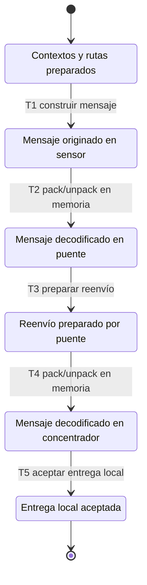

# Diseño STT del recorrido sensor–puente–concentrador

## Resultado vigente — integración ampliada (13 de octubre de 2026)

Suite completa verificada: **16 unitarios y 5 integraciones PASS**, sin fallos ni casos ignorados; análisis estático y regresión host PASS. Corrida `results/2026-10-13_integracion_90/`, en el nuevo repositorio LORA_MESH_TESTING con firmware copiado de SIMAI Mesh y los mismos módulos reales. El código de los tests se sincronizó en ambos clones; no se acredita una segunda ejecución en el clon original.

Cobertura de integración: **232/251 líneas (92,4 %), 132/168 ramas (78,6 %) y 21/21 funciones (100 %)**. Cobertura unitaria sin cambios: 90 % de líneas y 82,8 % de ramas. Los cinco casos están descritos en [casos_integracion.md](casos_integracion.md); IS-01 mantiene la derivación STT mostrada y los otros cuatro incorporan límites, errores, cambios de rutas y corrupción de mensajes. Son cinco funciones de test, algunas con variantes parametrizadas. El objetivo del 90 % se refiere a líneas.

La cobertura anterior de integración de 65,7 % correspondía a IS-01 sola. Las referencias a esa corrida en el historial no representan el resultado vigente. No se modificó firmware ni se usaron placas. `results/` continúa ignorada y no se hicieron commits ni push.


## Objeto de la prueba

Comprobar que un mensaje originado en el sensor llega al concentrador a través del puente, conservando identidad y contenido, y actualizando correctamente cabecera y contadores.

El sistema bajo prueba es la composición **de software** de tres contextos `network_layer` y del formato `mesh_frame`, en un único proceso de PC. Los enlaces se representan mediante serialización/deserialización en memoria. No se descarga firmware a una placa ni se utiliza radio, SPI o FreeRTOS. No se modelan propagación, pérdidas RF ni tiempos de transmisión.

Se aplica **State Transition Testing (STT)** a un modelo de especificación del recorrido exitoso del mensaje. Los estados describen situaciones observables del ensayo; no son estados de una máquina implementada en el firmware. Esto separa el diseño del comportamiento del sistema de los unitarios que prueban funciones individuales.

## Requerimientos y precondiciones

- RS-01: el sensor construye el mensaje con origen 1, destino 3 y próximo salto 2.
- RS-02: cada ciclo `pack/unpack` conserva todos los campos y bytes del mensaje.
- RS-03: el puente prepara el siguiente salto: TTL 4 → 3, hops 0 → 1, `prev_hop=2`, `next_hop=3`.
- RS-04: tipo, flags, origen, destino, ID, longitud y payload permanecen intactos durante todo el recorrido.
- RS-05: el concentrador acepta la entrega local y conserva la trama recibida.
- RS-06: al terminar, sensor `originated=1`, puente `forwarded=1`, concentrador `delivered_local=1`; los restantes contadores de cada nodo son cero.

Fixture independiente: nodos inicializados 1, 2 y 3; TTL por defecto 4; contadores en cero. Ruta del sensor al destino 3 vía 2, dos saltos; ruta del puente al destino 3 vía 3, un salto. Trama `DATA_BEST_EFFORT`; payload `{0x10, 0x20, 0x30, 0x40}`. Comprobar que la preparación de nodos y rutas devuelve `ESP_OK` antes de ejecutar la secuencia.

## Modelo de estados observables



Cada transición supone que se cumplen las precondiciones y que la API devuelve éxito. Un error o una salida distinta de la esperada hace fallar el test; no se continúa el recorrido como si hubiera ocurrido la transición.

## Tabla de transiciones y resultados esperados

| Transición | Estado previo | Acción / estímulo | Estado siguiente y resultado esperado |
|---|---|---|---|
| T1 | S0 | `network_layer_build_data(sensor, 3, …)` | S1: `ESP_OK`; origen 1, destino 3, prev 1, next 2, TTL 4, hops 0, payload intacto; sensor originated 1. |
| T2 | S1 | `mesh_frame_pack` y `mesh_frame_unpack` hacia contexto puente | S2: ambas operaciones OK; todos los campos iguales a S1; puente aún sin contadores incrementados. |
| T3 | S2 | `network_layer_prepare_forward(bridge, …)` | S3: `ESP_OK`; TTL 3, hops 1, prev 2, next 3; identidad y payload intactos; puente forwarded 1. |
| T4 | S3 | Segundo `pack/unpack`, hacia contexto concentrador | S4: todos los campos iguales a S3; concentrador aún sin contadores incrementados. |
| T5 | S4 | `network_layer_prepare_forward(concentrator, …)` | S5: `ESP_OK`; predicado de entrega local verdadero; trama conservada; concentrador delivered_local 1. |

## Derivación del script y criterio de selección

1. Partir de S0 con un fixture nuevo.
2. Recorrer las transiciones válidas del modelo hasta la entrega: **S0 → T1 → S1 → T2 → S2 → T3 → S3 → T4 → S4 → T5 → S5**.
3. Asignar las entradas concretas del fixture y las comprobaciones de la tabla a cada paso.
4. Implementar esa secuencia como **IS-01**. Sus comprobaciones intermedias impiden que un resultado final correcto oculte una alteración en una etapa anterior.

Resultado de la aplicación de STT: **una secuencia con cinco transiciones**, todas incluidas en IS-01. Se cubren las cinco transiciones del **modelo acotado de éxito**; eso no equivale a cubrir todas las transiciones del sistema real ni a un porcentaje de cobertura de código.

No se desarrollan en este modelo eventos ilegales, recuperación, duplicados, pérdida de enlace, ACK/reintentos o expiración de rutas. No se inventan auto-transiciones para ellos: la interfaz aquí ensayada no define una máquina de eventos de ese alcance. Los errores de contexto, próximo salto, TTL y ausencia de ruta tienen pruebas unitarias propias derivadas por CFT; no se presentan como recorridos STT de sistema ejecutados.

## Implementación y ejecución

Implementación: [test_multihop.c](../test/integration/test_multihop.c), test `test_IS01_sensor_bridge_concentrator_preserves_message_over_wire_format`. Los comentarios S0 y T1–T5 vinculan el script con las aserciones. `wire_roundtrip` comprueba la igualdad de todos los campos después de cada serialización.

Ejecutar desde `testing/`:

```powershell
./scripts/run.ps1
```

El runner ejecuta además los 16 unitarios, análisis estático, cobertura y regresión host. Los resultados se conservan localmente en `results/`, ignorada por Git. Consultar la corrida vigente en [ejecución y entrega](ejecucion_y_entrega.md); distinguir el diseño STT de la evidencia de ejecución. La cobertura de integración se reporta por separado de la unitaria.

## Relación con la consigna del docente

Este diseño corresponde al punto 3 de la última clase: mostrar un modelo, cómo se obtiene una prueba y su secuencia con resultados esperados. El punto 4 se demuestra con los unitarios Ceedling, el ejemplo de código, los logs y la cobertura. CFT se conserva como diseño complementario de los unitarios; STT permite presentar el recorrido del sistema de software sin recurrir a placas.

## Resultado verificado

Corrida `2026-10-10_stt_verificado`: IS-01 PASS con todas las comprobaciones S0/T1–T5. Suite completa: 16 unitarios y una integración PASS; análisis estático y regresión host PASS. Todo ejecutado en software en PC.
